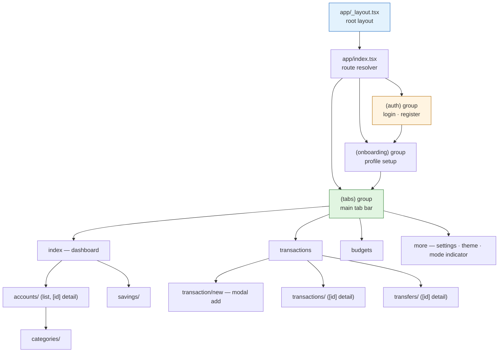

# Finora Mobile

Production-grade **React Native + Expo** client for the Finora personal-finance MVP.

Part of the [Finora monorepo](../../README.md). Product owner: Omran Khaled — عمران Khalid.

```text
Mobile = Client
Backend = Financial Authority
Shared Contracts = Agreement between Web, Mobile and API
```

## Stack

- React Native 0.86.3 + Expo SDK 57 (per `Apps/Mobile/package.json`)
- Expo Router (file-based routing) — tabs + modal add + stack subscreens
- TypeScript strict (TypeScript ~6.0.3)
- Native StyleSheet design tokens (no browser CSS)
- Expo SecureStore (session/token storage abstraction)
- Explicit mock API mode for development/test; swappable to the real `/api/v1` HTTP adapter
- Jest + jest-expo + @testing-library/react-native

## Navigation structure (Expo Router)



## Project structure

```
Apps/Mobile/
├── app/                 # Expo Router routes: (auth), (onboarding), (tabs),
│                        #   accounts, categories, savings, transaction, transactions, transfers
├── features/            # Feature modules: accounts, auth, budgets, categories,
│                        #   dashboard, more, savings, transactions, transfers
├── lib/
│   ├── api/             # adapter.ts, apiClient.ts, apiConfig, httpAdapter,
│   │                    #   mockAdapter, errors, idempotency, pagination
│   ├── auth/            # authService.ts
│   ├── network/         # networkMonitor.ts (NetInfo)
│   └── storage/         # secureStorage.ts (Expo SecureStore)
├── providers/           # Theme, auth/session providers
├── components/          # Shared UI
├── tokens/              # Design tokens
├── types/               # Shared TS types
├── tests/               # Jest suites (unit + integration + contract)
├── scripts/             # run-jest.cjs
├── assets/              # Static assets
├── app.json / package.json / tsconfig.json / eslint.config.js
└── .env.example         # EXPO_PUBLIC_API_URL, EXPO_PUBLIC_USE_REAL_API
```

## Commands

```bash
npm install
npm run typecheck   # tsc --noEmit
npm run lint         # eslint .
npm test             # jest
npm run export:ios # Metro production bundle (iOS)
npm run export:android    # Metro production bundle (Android)
npm start             # expo start
npm run start:lan      # Expo dev server reachable on the local network
npm run start:tunnel   # Expo dev server through an Expo tunnel
npm run start:clear    # Clear Metro cache and start
```

## Opening the development app on a phone

There are two separate connections to account for:

1. **Metro/Expo** serves the JavaScript bundle (normally on port `8081`).
2. **The API** serves Finora data (normally on port `3001`).

For a phone on the same Wi-Fi network:

```bash
# Terminal 1 — API
pnpm --dir .\Apps\api start

# Terminal 2 — Expo
pnpm --dir .\Apps\Mobile start:lan
```

Set `EXPO_PUBLIC_USE_REAL_API=1` and set `EXPO_PUBLIC_API_URL` to the
computer's LAN address, for example `http://192.168.1.20:3001`, before
starting Expo. Do not use `localhost` on a physical phone: on the phone it
means the phone itself. Windows Firewall must allow the selected ports on a
private network.

For a phone outside the local network, `--lan` cannot work. The recommended
solution is to deploy the API behind a real HTTPS host, set
`EXPO_PUBLIC_API_URL` to that origin, and run:

```bash
pnpm --dir .\Apps\Mobile start:tunnel
```

The Expo tunnel only exposes Metro; it does **not** expose the API. For a
short-lived development demo, expose the API separately with an HTTPS tunnel
such as Cloudflare Tunnel or ngrok, then use that HTTPS URL as
`EXPO_PUBLIC_API_URL`. Never expose PostgreSQL or a production database
directly, and do not use a development tunnel as a production deployment.

After changing public Expo environment variables, stop and restart Metro
(use `start:clear` if the old URL is still embedded). If Expo Web reports
`Page entered Back-Forward Cache` or `Cannot connect to Expo CLI`, reload the
page after Metro is running; those messages describe a stale browser/Metro
WebSocket connection, not an API response.

## API Switching

`EXPO_PUBLIC_API_URL` + `EXPO_PUBLIC_USE_REAL_API=1` switches the client
from the in-memory mock adapter to the real `/api/v1` HTTP adapter.

The shared development examples intentionally select demo mode
(`EXPO_PUBLIC_USE_REAL_API=0`): changes are volatile and reset when the app
restarts. A missing or invalid mode is an error rather than an implicit mock.
To see persistent API operations locally, set
`EXPO_PUBLIC_USE_REAL_API=1` and point `EXPO_PUBLIC_API_URL` at a running API.
The app identifies the active mode on the dashboard and in More; Demo mode is
not connected to or synchronized with backend data.

For production builds, set `EXPO_PUBLIC_API_URL` to the organization's real
HTTPS API origin (or a deployment path prefix before the API route), not a URL
already ending in `/api/v1`; the adapter appends `/api/v1` by default. The
production bundle requires `EXPO_PUBLIC_USE_REAL_API=1` and a valid HTTPS URL;
missing, malformed, or mock-mode configuration fails closed. Do not
use `.env.production.example`, an `example.com` host, or a placeholder URL as
a deployed endpoint. `EXPO_PUBLIC_USE_REAL_API=1` must also be set so
production bundles use the HTTP adapter rather than mock data. Expo reads
these public values while resolving config/export, so set them before creating
the production bundle.

For local development, start the API on port `3001`. The native adapter
automatically replaces `localhost` with the Expo host address when available
(and uses `10.0.2.2` as the Android emulator fallback). A physical device
must be on the same network as the computer running the API.

## Session, network, and storage flow

```mermaid
flowchart TD
    Launch[App launch] --> Mode{EXPO_PUBLIC_USE_REAL_API<br/>and EXPO_PUBLIC_API_URL set?}
    Mode -- No / 0 --> Mock[mockAdapter<br/>in-memory demo data, volatile]
    Mode -- Yes / 1 --> Real[httpAdapter<br/>appends /api/v1]
    Real --> Config{Config valid?<br/>HTTPS non-placeholder URL in production}
    Config -- No --> FailClosed[Fail closed — bundle build fails]
    Config -- Yes --> Login[Login / register via authService]
    Login --> Token[Access token received]
    Token --> Store[secureStorage.ts<br/>Expo SecureStore — encrypted at rest]
    Store --> Use[Subsequent requests:<br/>Authorization Bearer from SecureStore]
    Use --> Refresh[Session refresh<br/>sessionRefresh.test.ts coverage]
    Refresh --> Store
    Use --> Monitor[networkMonitor.ts (NetInfo)<br/>offline / reconnect awareness]
    Use --> Errors[errors.ts maps ErrorEnvelope<br/>error.code → user message]
    Mock --> Errors2[Mock errors mirror real envelopes<br/>invariant 12]

    style Mock fill:#fff4e1,stroke:#b26a00
    style Real fill:#e1f5e1,stroke:#2e7d32
    style FailClosed fill:#fdecea,stroke:#c62828
    style Store fill:#e3f2fd,stroke:#1565c0
```

**Notes:** In demo mode the app never contacts the backend (dashboard shows Demo mode indicator). Token storage uses Expo SecureStore (encrypted keychain/keystore), not AsyncStorage. Every financial write carries an `Idempotency-Key` via `lib/api/idempotency.ts`.

## Production assurance gates

- The API CI job uses its disposable PostgreSQL service, applies migrations,
  starts the compiled API with production configuration, waits on the
  database-backed readiness endpoint, and runs a real Web HTTP-client
  registration/account create/list smoke. It does not use a private database
  or a mocked API.
- Pull requests run the normal Mobile checks and a fail-closed Expo production
  config check with both store identifiers unset. It passes only when config
  fails with the expected missing-identifier validation error; no placeholder
  identity is treated as production-ready.
- The `release` event and manual `workflow_dispatch` run a separate production
  config job that requires these GitHub Actions **repository or organization
  variables** (not secrets): `FINORA_IOS_BUNDLE_ID`,
  `FINORA_ANDROID_PACKAGE`, and `EXPO_PUBLIC_API_URL`. Set them to the owning
  organization's real iOS bundle ID, Android application ID, and HTTPS API URL.
  Missing values or placeholder identifiers/endpoints fail the job. The API
  URL is public build configuration, not a credential.
- That job performs Expo production config resolution and iOS/Android Metro
  exports. Exports verify bundling/configuration only; they do **not** verify
  code signing, device runtime behavior, store-account ownership, or store
  submission. Those platform/store checks remain outstanding release gates.

## Notes

- The development bundle identifier (`com.finora.mobile`) is a placeholder,
  not an owning organization's production identifier.

- No private secrets exist in this bundle (Section 62).
- Single base currency per user; immutable after the first account (MVP).

## Tests

Run from `Apps/Mobile/`: `npm test` (via `scripts/run-jest.cjs`). Suites live in `tests/`:

| Suite | Coverage |
|-------|----------|
| `apiConfig.test.ts`, `appConfig.test.ts` | Env resolution, production fail-closed config |
| `httpAdapterContract.test.ts`, `mockContractShapes.test.ts` | Real ↔ mock contract parity (invariant 12) |
| `sessionRefresh.test.ts`, `apiSessionSync.test.ts` | Session refresh / sync |
| `secureStorage.test.ts` | SecureStore token persistence |
| `financialIdempotency.test.ts`, `financialEngine.test.ts` | Idempotency keys and derived-money rules |
| `onboardingFlow.test.ts`, `authProviderOnboarding.test.tsx` | Auth + onboarding navigation |
| `accountsScreen.test.tsx`, `accountDetailLoad.test.tsx`, `createAccountRefresh.test.tsx` | Accounts UI |
| `transactionNew.test.tsx`, `paginationBoundary.test.ts`, `errors.test.ts`, `format.test.ts` | Transactions, pagination, error mapping |
| `theme.test.ts`, `themeProvider.test.tsx`, `moreThemeSettings.test.tsx` | Design tokens / theming |
| `telemetry.test.ts`, `secondaryBackNavigation.test.tsx` | Telemetry, navigation |

## Related documentation

- [Finora monorepo root](../../README.md)
- [Shared contracts](../../packages/contracts/README.md)
- [API architecture](../api/README.md)