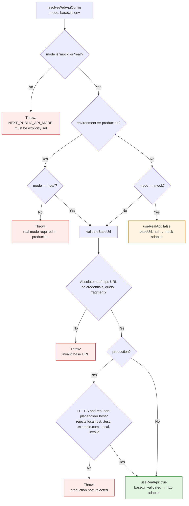
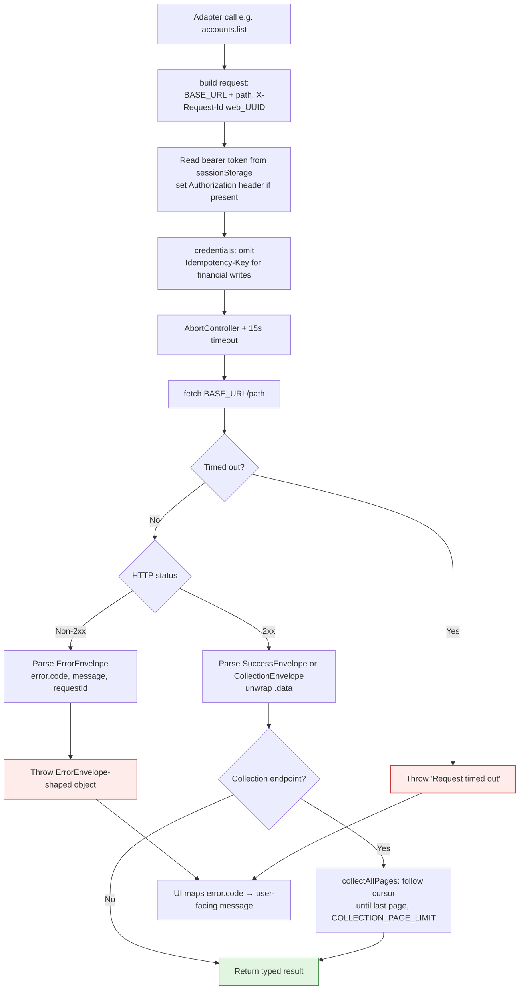

# Finora Web

Next.js web client (Next.js 16.4.0 per `Apps/Web/package.json`, App Router) for the Finora personal-finance platform. Displays financial data and requests changes through the API; the API remains the financial authority.

Part of the [Finora monorepo](../../README.md). Product owner: Omran Khaled — عمران Khalid.

---

## Responsibilities

- Authentication UI: login, register, onboarding
- Accounts: list, create, view, rename, archive
- Categories: list, create, update, archive
- Transactions: list, create, update, void
- Transfers: create, view
- Budgets: list, create, update, delete
- Savings goals: list, create, update, archive
- Dashboard: aggregated summary (balances, income, expenses, budgets, goals)

The Web app does **not** compute financial truth — it displays what the API returns and maps error codes to user-facing messages.

---

## API connection (Mock vs Real)

The Web client supports two adapters, selected at module load time:

| Mode | Env var | Behavior |
|------|---------|----------|
| **Mock** (default) | `NEXT_PUBLIC_API_MODE=mock` | In-memory mock server; volatile, contract-aligned |
| **Real** | `NEXT_PUBLIC_API_MODE=real` + `NEXT_PUBLIC_API_BASE_URL` | Real HTTP (`fetch`) to `/api/v1` |

`NEXT_PUBLIC_API_MODE` must be explicitly set to `mock` or `real`; a missing value throws. In production, `real` mode is required and the base URL must be a valid HTTPS non-placeholder host.

### Adapter selection flow



Files:
- `Apps/Web/lib/api-client.ts` — facade that selects mock vs http adapter
- `Apps/Web/lib/http-adapter.ts` — real HTTP adapter (bearer token from sessionStorage, 15s timeout)
- `Apps/Web/lib/mock-adapter.ts` — mock adapter wrapping the fixture server
- `Apps/Web/lib/api-config.ts` — `resolveWebApiConfig()` validation
- `Apps/Web/lib/session-store.ts` — token persistence (sessionStorage)

### HTTP request flow (real mode)



**Notes:** Every request carries an `X-Request-Id` (`web_<uuid>`); the adapter normalizes header casing and throws `ErrorEnvelope`-shaped objects so mock and real adapters behave identically (Mock behavior must not contradict real API behavior — invariant 12).

---

## Project structure

```
Apps/Web/
├── app/                 # Next.js App Router: (app), login, register, onboarding
├── lib/                 # api-client, http-adapter, mock-adapter, api-config, session-store, idempotency, format, types, pagination
├── components/          # layout, providers, shared, ui
├── hooks/
├── public/              # static assets (icon.svg, manifest.webmanifest)
├── tests/               # Vitest: unit (lib/, ui/) + integration (http-api smoke)
├── .env / .env.example  # NEXT_PUBLIC_API_MODE, NEXT_PUBLIC_API_BASE_URL, etc.
├── next.config.js
├── vitest.config.ts
├── vitest.integration.config.ts
├── tsconfig.json
├── package.json         # nextjs package
└── AGENTS.md            # Web-specific agent notes
```

---

## Commands (run from `Apps/Web/`)

| Command | Purpose |
|---------|---------|
| `pnpm --filter nextjs typecheck` | `tsc --noEmit` |
| `pnpm --filter nextjs lint` | ESLint |
| `pnpm --filter nextjs test` | Vitest unit suite |
| `pnpm --filter nextjs build` | Next.js production build |
| `pnpm exec vitest run --config vitest.integration.config.ts` | CI integration smoke (real HTTP against running API) |

---

## Known limitations

- Web typecheck reports diagnostics, mostly in generated `.next/types/validator.ts` — not from application source
- ESLint 9 cannot load the legacy `.eslintrc.json` config (flat config migration needed)
- Bearer token stored in `sessionStorage` — residual XSS exposure
- Defaults to Mock mode; real-mode integration not exercised outside CI

---

## Related documentation

- [Shared contracts](../../packages/contracts/README.md)
- [API architecture](../api/README.md)