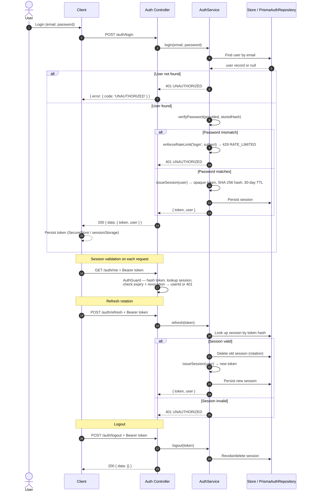
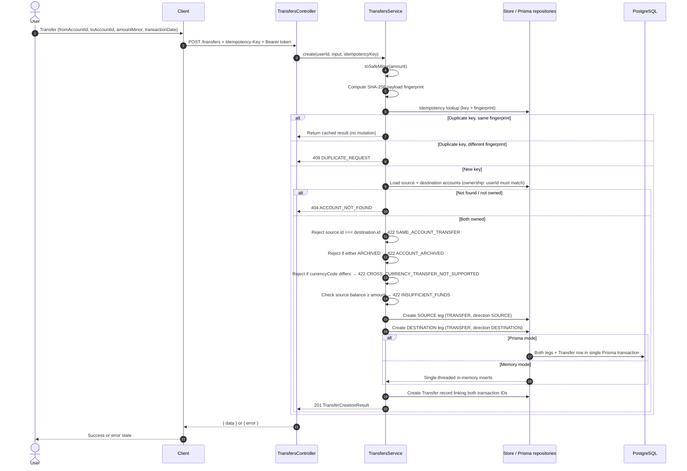
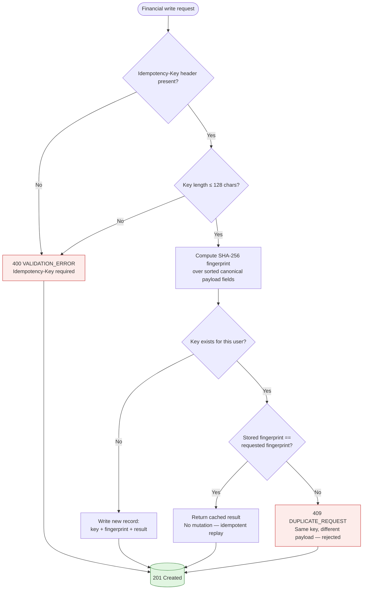
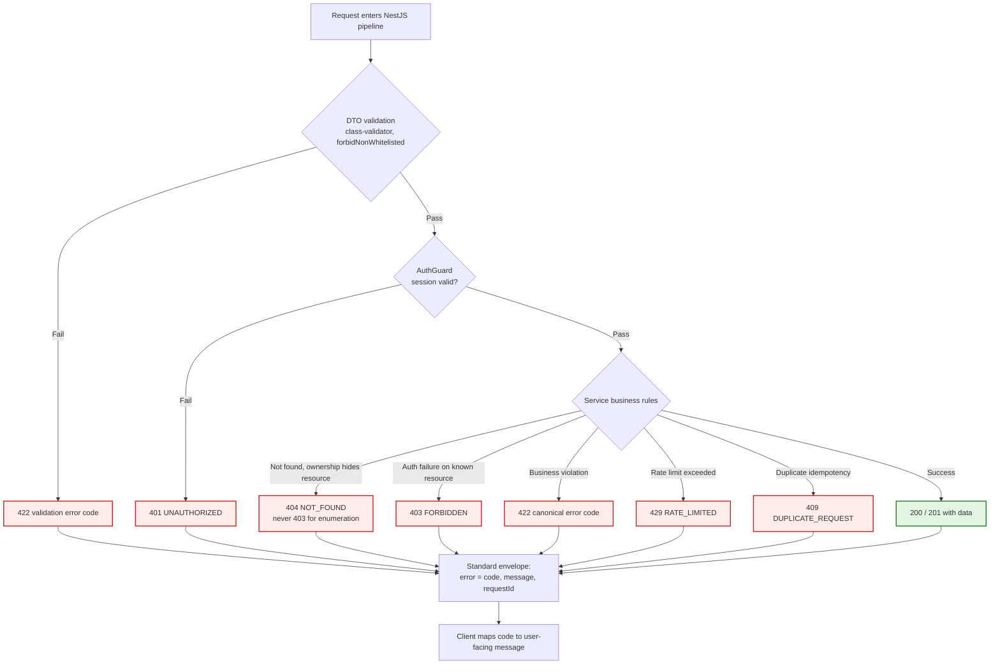

# Finora API

NestJS HTTP API — the **financial authority** for the Finora personal-finance platform. Validates ownership, enforces financial invariants, derives balances from transaction history, and serves versioned endpoints under `/api/v1`.

Part of the [Finora monorepo](../../README.md). Product owner: Omran Khaled — عمران Khalid.

---

## Architectural overview

```mermaid
flowchart TB
    subgraph HTTP["HTTP layer (/api/v1)"]
        CTRL[Controllers<br/>DTO validation<br/>class-validator + forbidNonWhitelisted]
    end

    subgraph Guard["AuthGuard"]
        VALIDATE[Validate bearer token<br/>SHA-256 hash → session → userId<br/>401 if invalid/expired/revoked]
    end

    subgraph SVC["Application services"]
        AUTH[AuthService<br/>register · login · logout · refresh · me]
        ACCT[AccountsService]
        TXN[TransactionsService]
        TRF[TransfersService<br/>atomic two-leg]
        BUD[BudgetsService]
        GOAL[GoalsService]
        DASH[DashboardService]
    end

    subgraph CORE["Core"]
        STORE[InMemoryStore<br/>default persistence]
        MONEY[money.ts<br/>toSafeMinor · fromMinor ·<br/>minorPercentage]
        IDEMP[idempotency.ts<br/>fingerprint ·<br/>Idempotency-Key validation]
        FILTER[api-exception.filter.ts<br/>standardized error envelope]
    end

    subgraph PERSIST["Persistence (runtime branch)"]
        PRISMA[Prisma repositories<br/>ENABLE_PRISMA=true]
        MEM[In-memory branch<br/>ENABLE_PRISMA=false/unset]
    end

    subgraph DB["PostgreSQL 16"]
        DB[(Relational store<br/>prisma/schema.prisma)]
    end

    HTTP --> CTRL
    CTRL --> GUARD
    GUARD --> SVC
    SVC --> CORE
    CORE --> PERSIST
    PERSIST --> DB

    style HTTP fill:#e3f2fd,stroke:#1565c0
    style Guard fill:#fff4e1,stroke:#b26a00
    style SVC fill:#e1f5e1,stroke:#2e7d32
    style CORE fill:#f3e5f5,stroke:#6a1b9a
    style PERSIST fill:#fce4ec,stroke:#880e4f
    style DB fill:#eceff1,stroke:#37474f
```

---

## Endpoints (all under `/api/v1`)

| Domain | Endpoints |
|--------|-----------|
| **Auth** | `POST /auth/register`, `POST /auth/login`, `POST /auth/logout`, `POST /auth/refresh`, `GET /auth/me` |
| **Accounts** | `GET/POST /accounts`, `GET/PATCH /accounts/:id`, `POST /accounts/:id/archive` |
| **Categories** | `GET/POST /categories`, `GET/PATCH /categories/:id`, `POST /categories/:id/archive` |
| **Transactions** | `GET/POST /transactions`, `GET/PATCH /transactions/:id`, `POST /transactions/:id/void` |
| **Transfers** | `POST /transfers`, `GET /transfers/:id` |
| **Budgets** | `GET/POST /budgets`, `GET/PATCH /budgets/:id`, `DELETE /budgets/:id` |
| **Savings goals** | `GET/POST /savings-goals`, `GET/PATCH /savings-goals/:id`, `POST /savings-goals/:id/archive` |
| **Dashboard** | `GET /dashboard/summary` |
| **Health** | `GET /health`, `GET /ready` |
| **Docs** | `GET /docs` (Swagger, disabled in production) |

All financial writes require an `Idempotency-Key` header. Responses use standardized envelopes: `{ data }` on success, `{ error: { code, message, requestId } }` on failure.

---
## Execution flows

### Authentication: login → session → refresh



### Atomic transfer between two accounts



**Atomicity (implemented):** In Prisma mode, both transfer legs and the transfer record are written inside a single Prisma transaction. In memory mode, the single-threaded in-memory store performs all mutations before returning. Either both legs persist or neither does. FI-002 (transfer does not change total money) is preserved.


---

## Financial algorithms

### Money representation (minor units, bigint)

Money is stored and transmitted as **integer minor units** (e.g. cents for USD), never as floating point.

- **Database:** `BIGINT` columns (`amount_minor`, `opening_balance_minor`, `limit_minor`, `target_amount_minor`)
- **API → client:** serialized as **decimal strings** (`MoneyMinor = string` in contracts) to survive JSON number precision loss
- **Upper bound:** `POSTGRES_BIGINT_MAX = 9223372036854775807n`
- **`toSafeMinor(value)`** rejects non-decimal-integer strings, negative numbers, non-safe-integers, and values exceeding `POSTGRES_BIGINT_MAX` with `422 INVALID_AMOUNT`
- **`fromMinor(bigint)`** returns `value.toString()` — no number coercion

### Account balance calculation

```mermaid
flowchart TD
    Start[accountBalance(accountId)] --> Load[Load account from store]
    Load --> Null{Account exists?}
    Null -- No --> Zero[Return 0n]
    Null -- Yes --> Init[balance = opening_balance_minor]
    Init --> Loop[For each transaction]
    Loop --> Match{accountId matches?}
    Match -- No --> Skip[Skip transaction]
    Match -- Yes --> Void{status == VOIDED?}
    Void -- Yes --> Skip
    Void -- No --> Sign{type == INCOME or<br/>transferDirection == DESTINATION?}
    Sign -- Yes --> Add[balance += amountMinor]
    Sign -- No --> Sub[balance -= amountMinor]
    Add --> Next[Next transaction]
    Sub --> Next
    Skip --> Next
    Next --> More{More transactions?}
    More -- Yes --> Loop
    More -- No --> Result[Return balance]

    style Zero fill:#e1f5e1,stroke:#2e7d32
    style Result fill:#e1f5e1,stroke:#2e7d32
```

**Key points:**
- Voided transactions are skipped (FI-003)
- TRANSFER legs use `transferDirection` to determine sign (SOURCE subtracts, DESTINATION adds)
- INCOME adds, EXPENSE subtracts
- Balance is **derived**, not stored — computed from opening balance + active, non-voided transactions
- In Prisma mode, `balancesForUser(userId)` performs a single aggregated query


### Idempotency: Idempotency-Key + payload fingerprint



**Where enforced:** `Apps/api/src/core/idempotency.ts` (`fingerprint`, `assertMatchingFingerprint`, `normalizeIdempotencyKey`). Applied in `transactions.service.ts` and `transfers.service.ts`.


### Error handling



**Canonical error codes:** `INVALID_AMOUNT`, `INVALID_CURRENCY`, `ACCOUNT_NOT_FOUND`, `ACCOUNT_NOT_OWNED`, `ACCOUNT_ARCHIVED`, `ACCOUNT_HAS_ACTIVE_GOAL`, `CATEGORY_NOT_FOUND`, `INVALID_CATEGORY_TYPE`, `TRANSACTION_NOT_FOUND`, `TRANSACTION_ALREADY_VOIDED`, `INSUFFICIENT_FUNDS`, `SAME_ACCOUNT_TRANSFER`, `CROSS_CURRENCY_TRANSFER_NOT_SUPPORTED`, `BUDGET_ALREADY_EXISTS`, `BUDGET_NOT_FOUND`, `GOAL_NOT_FOUND`, `DUPLICATE_REQUEST`, `BASE_CURRENCY_MISMATCH`, `BASE_CURRENCY_LOCKED`, `RATE_LIMITED`, `UNAUTHORIZED`, `FORBIDDEN`, `VALIDATION_ERROR`, `INTERNAL_ERROR`, `SERVICE_UNAVAILABLE`.

---

## Project structure

```
Apps/api/
├── src/
│   ├── app.module.ts        # Module registry
│   ├── main.ts              # Bootstrap: env load, CORS, security headers, Swagger, listen
│   ├── config/
│   │   ├── persistence.ts   # ENABLE_PRISMA resolver (isPrismaPersistenceEnabled)
│   │   └── production.ts    # validateProductionConfiguration()
│   ├── core/
│   │   ├── store.ts                 # InMemoryStore + Prisma repository branches
│   │   ├── money.ts                 # toSafeMinor, fromMinor, minorPercentage
│   │   ├── idempotency.ts           # fingerprint, Idempotency-Key validation
│   │   ├── pagination.ts
│   │   └── api-exception.filter.ts  # Standardized error envelope
│   ├── auth/                # register, login, logout, refresh, me, guard, repository
│   ├── accounts/            # service, controller, dto, module
│   ├── categories/          # service, controller, dto, module
│   ├── transactions/        # service, controller, dto, module
│   ├── transfers/           # service, controller, dto, module
│   ├── budgets/             # service, controller, dto, module
│   ├── goals/               # savings goals service, controller, dto, module
│   ├── dashboard/           # service, controller, dto, module
│   ├── health/              # /health and /ready controllers
│   ├── database/            # PrismaService, repositories (Prisma + in-memory branches)
│   └── swagger/             # setup.ts, schemas.ts (OpenAPI models)
├── test/                    # Jest suites (memory-mode + DB-gated + production e2e)
├── .env                     # Local API environment (ENABLE_PRISMA=true in this checkout)
├── .env.development.example
├── .env.production.example
├── package.json             # @finora/api
├── tsconfig.json
├── nest-cli.json
└── jest.config.js
```

---

## Commands (run from `Apps/api/`)

| Command | Purpose |
|---------|---------|
| `pnpm start` | Start local API (reads `Apps/api/.env`) |
| `pnpm stop` | Stop local API |
| `pnpm start:dev` | Start with `nest start --watch` |
| `pnpm typecheck` | `tsc --noEmit` |
| `pnpm build` | `nest build` |
| `pnpm test` | `jest --runInBand` + local process test |
| `pnpm test:production` | Production e2e (`ENABLE_PRISMA=true`) |
| `pnpm db:generate` | Generate Prisma Client |
| `pnpm db:validate` | Validate Prisma schema |
| `pnpm db:migrate:deploy` | Apply migrations to target DB |

---

## Environment variables

| Variable | Meaning |
|----------|---------|
| `NODE_ENV` | `development` or `production` |
| `PORT` | HTTP listen port (default `5000`) |
| `DATABASE_URL` | PostgreSQL connection string (required in production) |
| `ENABLE_PRISMA` | `true` → Prisma/PostgreSQL; `false`/unset → in-memory |
| `CORS_ORIGINS` | Comma-separated allowed CORS origins |
| `TRUST_PROXY` | `true`/`false` — trust X-Forwarded-For behind proxy |
| `ENABLE_SWAGGER` | Must not be `true` in production |
| `LOG_LEVEL` | Logging level |

**Never commit real credentials.** See `.env.development.example` and `.env.production.example`.

---

## Related documentation

- [Database schema and migrations](../../prisma/README.md)
- [Shared contracts](../../packages/contracts/README.md)
- [Domain Money primitive](../../packages/domain/README.md)
- [Web adapter layer](../Web/README.md)