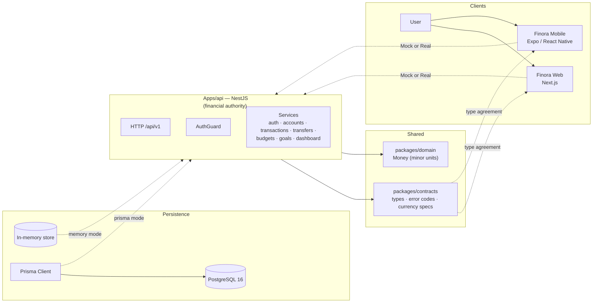

# Finora

Personal-finance platform where the **API is the financial authority**. Clients (Web and Mobile) display data and request changes, while the API validates ownership, enforces invariants, and derives balances from transaction history.

**Product owner:** Omran Khaled 

---

## What Finora does (implemented)

Finora is a personal-finance MVP with these capabilities:

- **Authentication:** email/password registration, login, logout, token refresh rotation, profile (`me`), base-currency update
- **Accounts:** create, list, paginated list, get, rename, archive; types `CASH`/`BANK`/`SAVINGS`; status `ACTIVE`/`ARCHIVED`
- **Categories:** system and user-owned, `INCOME`/`EXPENSE`, `ACTIVE`/`ARCHIVED`
- **Transactions:** income, expense, transfer legs; `ACTIVE`/`VOIDED`; integer minor units; void support
- **Transfers:** atomic same-currency transfer between two accounts owned by the same user; two `TRANSFER` legs; idempotent via `Idempotency-Key`
- **Budgets:** per user/category/year/month spending limits with usage calculation
- **Savings goals:** 1:1 linked to an account; target amount; progress derived from linked account balance
- **Dashboard:** aggregated balances, income, expenses, budgets, goals (archived accounts excluded)
- **Two persistence modes:** in-memory store (default) or Prisma/PostgreSQL (`ENABLE_PRISMA=true`)
- **Web and Mobile clients**, each with a Mock adapter (default) and a Real HTTP adapter (opt-in)

---

## Architecture at a glance



The full architectural detail — execution flows, ERD, use cases, algorithms, contracts, testing, and operations — lives in the **component READMEs** linked below (each embeds its own Mermaid diagrams).

---

## Repository

| Component | Location |
|-----------|----------|
| API (NestJS) | `Apps/api/` |
| Web client (Next.js) | `Apps/Web/` |
| Mobile client (Expo) | `Apps/Mobile/` |
| Shared contracts | `packages/contracts/` |
| Domain primitives | `packages/domain/` |
| Prisma schema + migrations | `prisma/` |
| CI pipeline | `.github/workflows/ci.yml` |

---

## Quick start

```bash
# 1. Install dependencies
pnpm install --frozen-lockfile

# 2. Generate Prisma Client
pnpm db:generate

# 3. Apply migrations (requires a running PostgreSQL and DATABASE_URL)
pnpm db:migrate:deploy

# 4. Typecheck all packages
pnpm typecheck

# 5. Run all tests
pnpm test

# 6. Build API and Web
pnpm build

# 7. Export Mobile bundles
pnpm export:mobile
```

The API starts on `PORT` (default `5000`; local `Apps/api/.env` uses `3001`). Versioned endpoints are under `/api/v1`.

### Environment modes

Both clients default to **Mock** mode (in-memory adapter). To use the real API:

- **Web:** set `NEXT_PUBLIC_API_MODE=real` and `NEXT_PUBLIC_API_BASE_URL`
- **Mobile:** set `EXPO_PUBLIC_USE_REAL_API=1` and `EXPO_PUBLIC_API_URL`

Production requires real mode with valid HTTPS URLs. See the component READMEs for details.

---

## Status

**Hardened release candidate — not yet certified production GO.** Static gates (typecheck, build, contract drift, tests in memory mode) pass. Runtime gates (clean install, PostgreSQL-backed API boot, real Web/Mobile → API smoke flows, Mobile store signing, hosted CI) are not certified from this environment.

---

## Component guides

- [API](Apps/api/README.md)
- [Web](Apps/Web/README.md)
- [Mobile](Apps/Mobile/README.md)
- [Contracts](packages/contracts/README.md)
- [Domain](packages/domain/README.md)
- [Prisma schema](prisma/README.md)