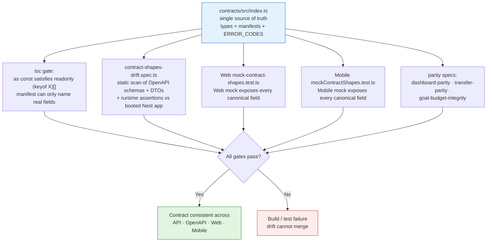

# @finora/contracts

Shared API contract for the Finora personal-finance platform. The **single authoritative source** for API resource/request/response interfaces, field manifests, error codes, and currency specifications.

Part of the [Finora monorepo](../../README.md). Product owner: Omran Khaled — عمران Khalid.

---

## Responsibility

`packages/contracts/src/index.ts` owns every resource/request/response shape (`*` interfaces) and the exact public field sets (`*_API_FIELDS`, `*_REQUEST_FIELDS`). Every other surface in the repository is derived from, or asserted against, this package:

- **API runtime** (`Apps/api/src/**`) — produces the payloads
- **OpenAPI models** (`Apps/api/src/swagger/schemas.ts`) — documents the payloads
- **NestJS DTOs** (`Apps/api/src/**/*.dto.ts`) — accept request bodies
- **Web types** (`Apps/Web/lib/types.ts`) and **Mobile types** (`Apps/Mobile/types/contract.ts`) — re-export canonical types, never redefine them
- **Web mock** and **Mobile mock** — must behave like the real API

---

## What's in the package

| Export group | Contents |
|--------------|----------|
| Types | `User`, `AuthSession`, `Account`, `Category`, `Transaction`, `Transfer`, `TransferCreationResult`, `Budget`, `SavingsGoal`, `DashboardSummary`, `DashboardBudget`, `DashboardGoal` |
| Request types | `RegisterRequest`, `LoginRequest`, `UpdateProfileRequest`, `CreateAccountRequest`, `CreateCategoryRequest`, `CreateTransactionRequest`, `CreateTransferRequest`, `CreateBudgetRequest`, `CreateSavingsGoalRequest`, `TransactionFilters`, etc. |
| Envelopes | `ApiSuccess<T>`, `ApiCollection<T>`, `ApiError`, `SuccessEnvelope<T>`, `CollectionEnvelope<T>`, `ErrorEnvelope` |
| Enums / constants | `ACCOUNT_TYPES`, `TRANSACTION_TYPES`, `TRANSACTION_STATUSES`, `ACCOUNT_STATUSES`, `CATEGORY_TYPES`, `CATEGORY_STATUSES`, `GOAL_STATUSES`, `TRANSFER_DIRECTIONS`, `ERROR_CODES`, `ClientErrorCode` |
| Currency | `CURRENCY_SPECS` (code, symbol, label, minorUnit), `SUPPORTED_CURRENCIES`, `CURRENCY_MAP`, `isSupportedCurrency()`, `currencyMinorUnit()` |
| Field manifests | `*_API_FIELDS` and `*_REQUEST_FIELDS` — `as const satisfies readonly (keyof X)[]`, asserted at build time |

---

## How drift is prevented



1. `as const satisfies readonly (keyof X)[]` — a manifest can only name real interface fields (`tsc` gate)
2. `Apps/api/test/contract-shapes-drift.spec.ts` — static scan of OpenAPI schemas + DTOs, plus runtime assertions against a booted Nest app
3. `Apps/Web/tests/lib/mock-contract-shapes.test.ts` — Web mock exposes every canonical field
4. `Apps/Mobile/tests/mockContractShapes.test.ts` — Mobile mock exposes every canonical field
5. `Apps/api/test/dashboard-parity.spec.ts`, `transfer-parity.spec.ts`, `goal-budget-integrity.spec.ts` — in-memory and Prisma branches return identical payloads

---

## Project structure

```
packages/contracts/
├── src/index.ts   # All types, constants, manifests (main entry)
├── package.json   # @finora/contracts (private, version 0.1.0)
└── README.md      # this file
```

**No build step** — `main` and `types` point directly at `src/index.ts`. Consumers import the package directly.

---

## Commands

Typecheck and tests run through the consuming workspaces:

```bash
# From repository root
pnpm typecheck:api      # includes contracts via API imports
pnpm test:api           # includes contract-shapes-drift.spec.ts
```

---

## Related documentation

- [Domain package](../domain/README.md) — `Money` primitive used by contracts

> The canonical contract snapshot and public-surface parity matrix previously lived under `docs/contracts/`; with documentation README-only, `packages/contracts/src/index.ts` itself is the single source of truth, and the parity evidence is the drift-test suite described above.